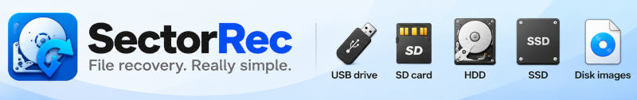
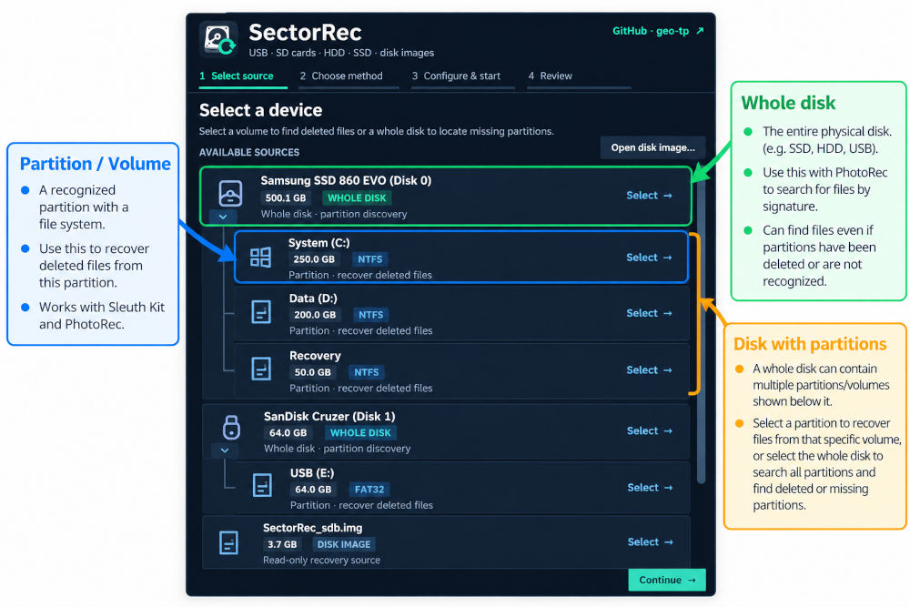
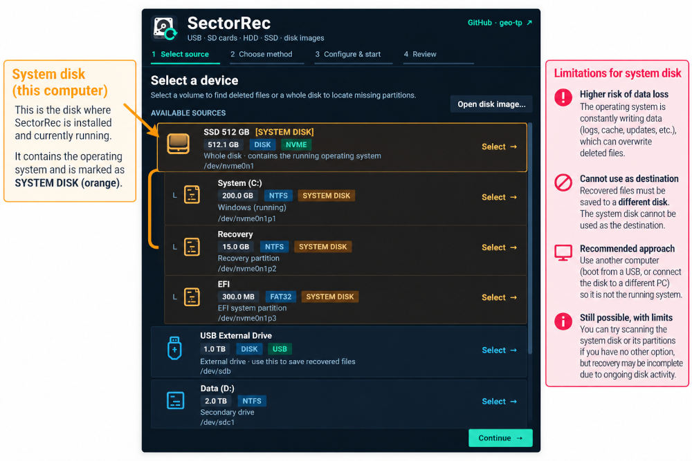
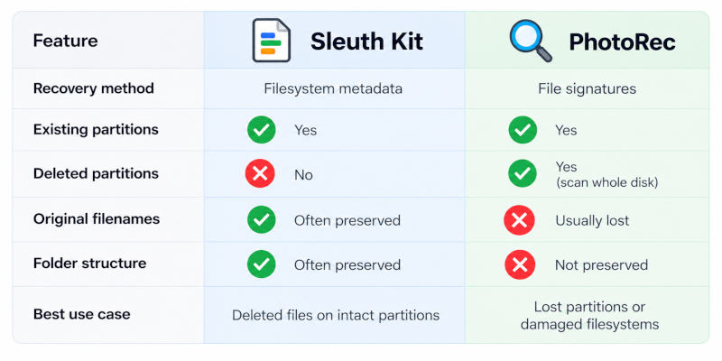
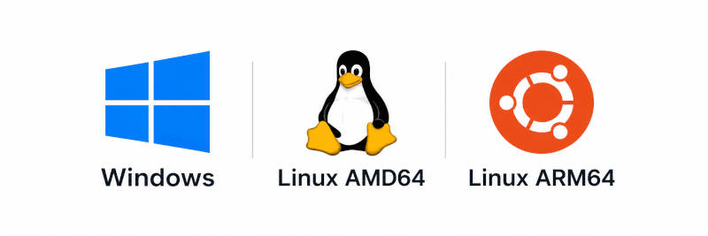

# SectorRec

**Recover deleted files. Find lost partitions. Make a safer copy of a failing disk.** SectorRec is an intuitive, step-by-step file recovery app. 

No technical expertise required: just select your device or disk image, choose a recovery method, and let SectorRec guide you through the process.

>A clicking drive, a device that repeatedly disconnects or important data on a rapidly failing disk may call for a recovery specialist before another power-on. **Software cannot repair damaged hardware**. [Click here for a recovery guide and for more informations](https://geo-tp.github.io/SectorRec)

## Features

- Find deleted files with their original names using **The Sleuth Kit**, when filesystem records are still available.
- Recover files even when directory records are lost using **PhotoRec**, which searches for recognizable file signatures.
- Locate missing partitions with **TestDisk** and inspect recoverable files without rewriting the partition table.
- Create a disk image with **GNU ddrescue** and resume interrupted copies using a saved recovery map.
- Open existing disk images (`.img`, `.dd`, `.raw`, `.bin`) instead of repeatedly scanning the original drive.
- Check device details and available **SMART information** before deciding how to proceed.

### Desktop interface

Current desktop interface, with a fictional **Photos** volume (48 GB) on a USB drive.

## Getting started

### Disks and Volumes

In this example, **Photo USB** is the whole disk; **Photos** and **Documents** are its partitions. **Backup SSD** is a separate device for recovered files. All devices shown are fictional.

### System Disks

The **SYSTEM DISK** badge identifies the computer's system drive and its volumes. In this fictional example, recover from **Computer SSD** and save to the separate **Backup USB**, not another partition on the same SSD.

### Recovery Methods

SectorRec offers two complementary recovery methods: The Sleuth Kit recovers files from existing partitions using filesystem metadata, while PhotoRec scans for file signatures and can recover data even from deleted partitions by selecting the whole disk.

Whenever possible, try both recovery methods to maximize your chances of finding missing files. When a device has no visible partitions, you can scan the disk for traces of lost partitions and, if filesystem metadata can be discovered, use them to search for files.

Sleuth Kit (metadata) allows you to browse the scan results and select specific files to recover, while PhotoRec (signatures) automatically recovers all files matching your selected file extensions and saves them to the destination folder during the scan. PhotoRec's live list is only for monitoring recovery progress.

>When recovering deleted files from your system drive, **don’t save the recovered files back to that same drive**. Doing so could overwrite data that is still recoverable. Always use a second drive as the recovery destination. For example, if you want to recover deleted files from your Windows system drive (C:), use a USB flash drive or an external hard drive to save the recovered files. Even better, use SectorRec on another computer by connecting your original system drive as a secondary drive. This avoids booting from the affected drive and minimizes the risk of overwriting recoverable data.

| Your situation | Use | What to expect |
| --- | --- | --- |
| You deleted files, and the filesystem still works | **Sleuth Kit · Metadata recovery** | Browse names, sizes and paths, filter the results, then recover only the files you choose. |
| Filesystem records are damaged or no longer list your files | **PhotoRec · Signature recovery** | Recover recognizable file contents; original names/folders are usually lost. May find non-deleted files too. |
| A partition disappeared or its table is damaged | **TestDisk · Find lost partitions** | Search for candidate partitions, then inspect their files if readable. SectorRec does **not** rewrite the partition table. |
| The drive is unstable, or you want a reusable copy | **Create disk image · ddrescue** | Copy readable areas first, preserve a `.map`, and retry or resume later. |

### Work with disk images

Open an existing disk image as a source for recovery. SectorRec supports common raw disk image formats, including `.img`, `.dd`, `.raw`, `.bin`.

Whenever possible, it is recommended to work on a disk image rather than the physical drive itself. This preserves the original disk and can significantly speed up file recovery scans, especially when working with slow or damaged drives.

On Linux desktop, an additional Mount image read-only action can expose recognizable filesystems in your file manager. Mounting is optional: SectorRec can scan images without mounting them.

### Resume an interrupted ddrescue image

SectorRec's imaging workflow keeps an `.img`, a ddrescue `.map`, and a `.source.json` file describing the original disk. If the copy stops at, say, 20%, use Resume an incomplete image… with the same original source drive and the existing files. ddrescue uses the map to continue from recorded progress and retry unreadable areas; it does not promise recovery of physically unreadable sectors.

**Keep all three files together.** Never resume an image using a different source disk, and never save the image on the disk being copied.

### Device information and SMART

Device details shows available model, size and filesystem information, plus a SMART report when supported. Missing SMART information does **not** mean the device is healthy, and a passing SMART status is not a guarantee either.

## Platform support

Download the latest version of SectorRec from the [GitHub Releases page](https://github.com/geo-tp/SectorRec/releases/latest).

---

**Built around established recovery tools:** [The Sleuth Kit](https://www.sleuthkit.org/), [TestDisk & PhotoRec](https://www.cgsecurity.org/), and [GNU ddrescue](https://www.gnu.org/software/ddrescue/). 
